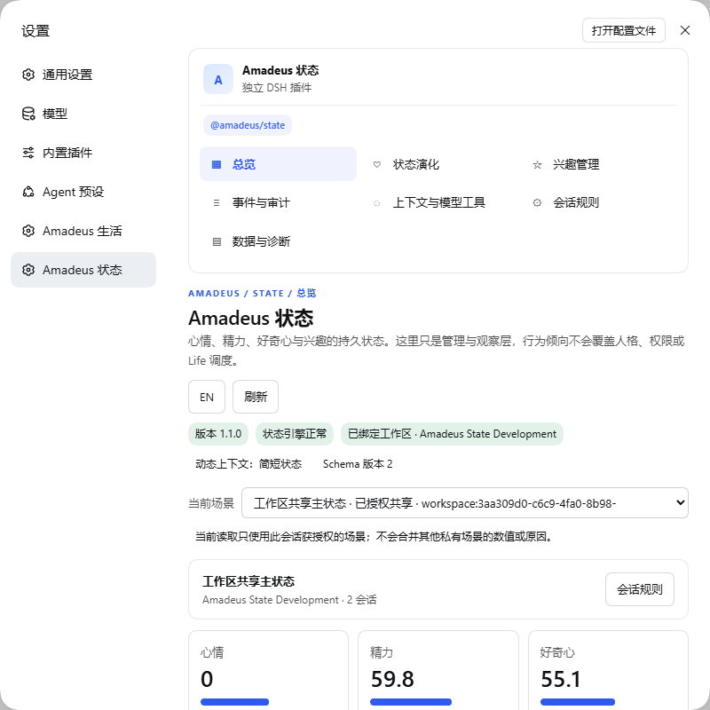

# Amadeus State

[简体中文](README.zh-CN.md) · [Detailed configuration](REFERENCE.md) · [Issues](https://github.com/jeskoky-pixel/amadeus-state/issues)

Shared Workspace state with persistent evolution history.

Target package: **`@fg-lab/amadeus-state@1.2.0`**. Tested runtime baseline: official DSH Desktop **0.2.1-rc.3**. MIT licensed.

## Release status

Productization candidate. Public npm and GitHub Release publication are pending release gates and npm account authorization. A version in this README is not evidence of publication. See [publishing policy](docs/PUBLISHING.md).

## What you can do

- Maintain mood, energy, curiosity and interest weights with persistent events and evolution history.
- Bind a Workspace and configure supported Session overrides, exclusions and evolution rules.
- Inspect current values, rules and stored history through the native DSH settings visualizations.

Example: inspect an interest's current weight and event history, change an evolution rule, and verify the subsequent state update without rewriting long-term memories.

State represents current condition and change; Memory stores facts, experiences and long-term knowledge. It does not replace Persona's core identity. QQ-specific Scene rules and unavailable optional Memory-write contracts must not be assumed supported; consult the detailed reference for the implemented boundary.

## Install and configure

Install the prebuilt `.tgz` with the official DSH plugin manager into your selected Profile. No local source build is required. Follow [installation instructions](docs/INSTALL_V1_2.md); do not copy configuration into a running Profile by hand.

Use native DSH settings to choose a Workspace and inspect state and evolution rules.

The other Amadeus plugins are optional. Install only the integrations you need.

## Interface

This is a recorded interface screenshot, not evidence that every real platform capability passed the current release gate. See the detailed reference and verification reports for limitations.

## Upgrade and recovery

Back up user data before upgrading. Code, persistent user data and recovery backups are separate. Disable stops functionality; uninstall is intended to retain external data. Restoring old code alone does not reverse a database migration.

- [Upgrade policy](docs/UPGRADE_POLICY.md)
- [Data migration and recovery](docs/DATA_MIGRATION.md)
- [Release checklist](docs/RELEASE_CHECKLIST.md)
- [Full configuration and limitations](REFERENCE.md)

## Ecosystem and license

[Amadeus project](https://github.com/jeskoky-pixel/Amadeus-dsh) · [MIT license](LICENSE)
